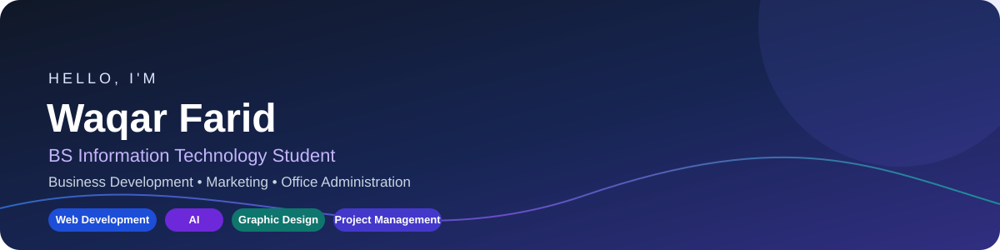
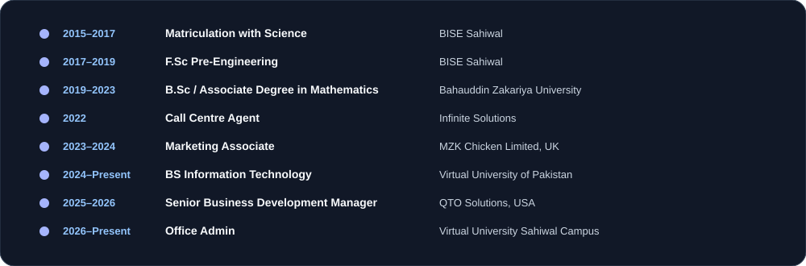

# Waqar Farid

**BS Information Technology Student | Business Development & Office Administration**

  

## 

I am pursuing a **BS in Information Technology at Virtual University of Pakistan** and have professional experience in business development, marketing, call-centre operations, and office administration. I enjoy working with people from diverse backgrounds, taking on challenges, and applying problem-solving, communication, and negotiation skills.

## 

| Role | Organization | Dates |
|---|---|---|
| Office Admin | Virtual University Sahiwal Campus | July 2026 – Present |
| Senior Business Development Manager | QTO Solutions, USA | July 2025 – May 2026 |
| Marketing Associate | MZK Chicken Limited, UK | October 2023 – March 2024 |
| Call Centre Agent | Infinite Solutions | July 2022 – October 2022 |

## 

## 

- **Business development and marketing** — experience in business development and marketing roles.
- **Office administration** — currently supporting office administration at Virtual University Sahiwal Campus.
- **Call-centre operations** — customer-facing experience as a Call Centre Agent.
- **Technology learning** — studying Information Technology, with interests and skills in web development, artificial intelligence, and graphic design.

## 

### Core Skills

  
  
  
  
  
  
  
  
  
  

## 

| Area | Competencies |
|---|---|
| Business | Business development, marketing, negotiation |
| Operations | Office management, project management, field work survey |
| People | Communication, team management, working with diverse backgrounds |
| Personal | Problem-solving, adaptability, commitment to work ethics |

## 

| Qualification | Institution / Board | Dates |
|---|---|---|
| BS Information Technology (ongoing) | Virtual University of Pakistan | 2024 – Present |
| B.Sc / Associate Degree in Mathematics | Bahauddin Zakariya University, Multan | 2019 – 2023 |
| F.Sc Pre-Engineering | BISE Sahiwal | 2017 – 2019 |
| Matriculation with Science | BISE Sahiwal | 2015 – 2017 |
| Office Management Diploma | Council of Vocational and Paramedical Education, Lahore, Pakistan | 2017 – 2019 |

## 

- English
- Urdu
- Punjabi
- Korean

## 

- **Email:** waqarfarid423@gmail.com

  
  Thanks for visiting my profile!

